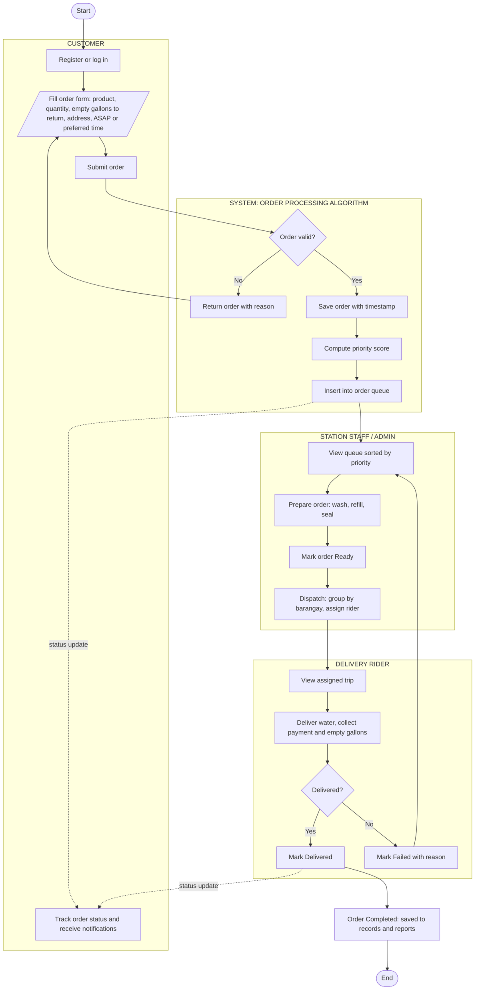
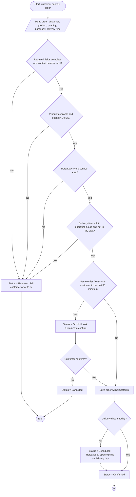
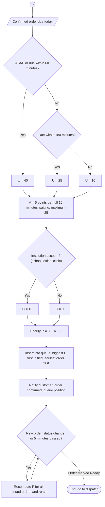
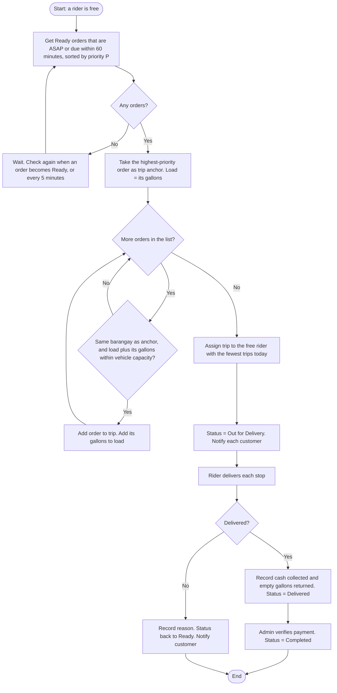
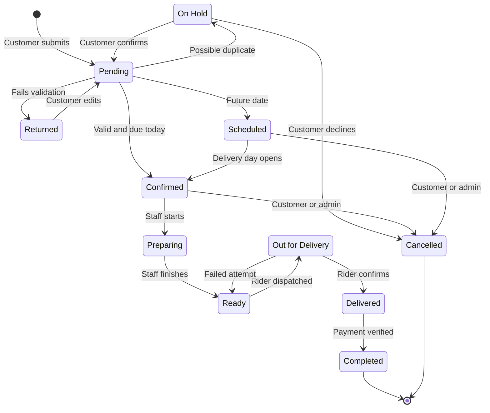
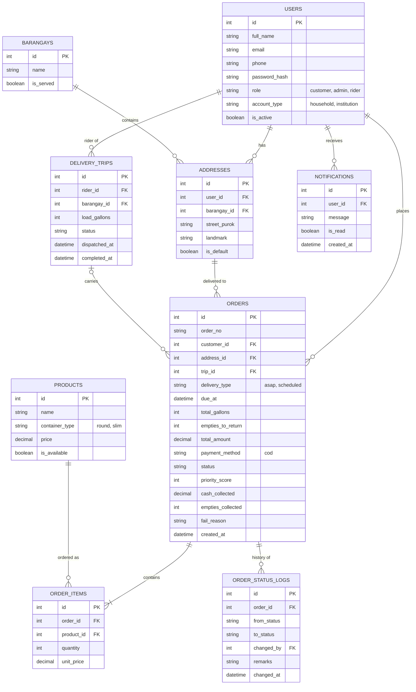
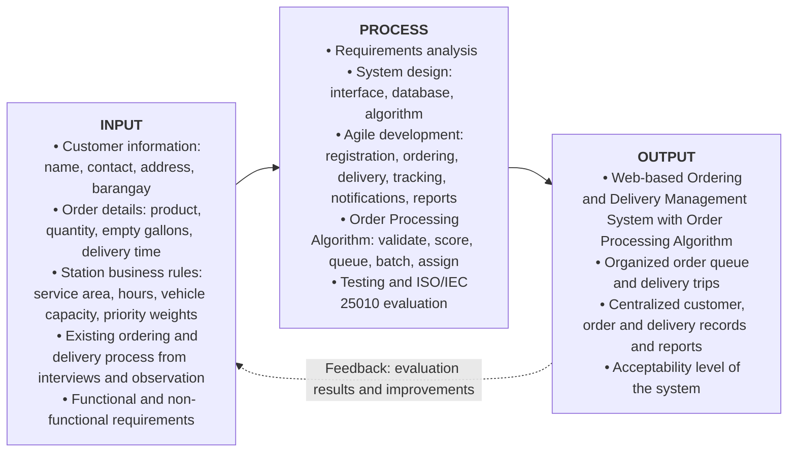

Thesis analysis · BS Computer Science · University of Antique – Hamtic Campus

# Hamtic Water Delivery Blueprint

An analysis of the thesis *Design and Development of a Web-Based Ordering and Delivery Management System Using an Order Processing Algorithm for Water Refilling Stations in Hamtic, Antique*. It covers the problem, the system design, a concrete order processing algorithm, flowcharts, and a step-by-step plan to build the system and finish the manuscript.

3 user roles7 modules4-stage algorithm7 diagrams12 manuscript fixes

## Contents

1. [At a glance](#glance)
2. [The problem](#problem)
3. [The solution](#solution)
4. [System flow](#flow)
5. [The algorithm](#algorithm)
6. [Try the algorithm](#simulator)
7. [Order statuses](#status)
8. [Database design](#database)
9. [Tools to use](#stack)
10. [How to build it](#build)
11. [Manuscript fixes](#fixes)

At a glance

## What this study is really about

The problem

Water refilling stations in Hamtic take orders by call, text, Messenger and walk-in, and write them in notebooks. When many orders arrive at once, orders get missed or doubled, addresses are wrong, nobody has a clear rule for which order goes first, and customers keep calling to ask where their water is.

The solution

A responsive website where customers order and track deliveries, staff work from an automatically sorted order queue, and riders get grouped delivery trips. An **order processing algorithm** validates each order, scores its priority, queues it, and groups ready orders into trips by barangay.

The biggest gap

The paper never says *what* the algorithm's rules are. It only mentions "predefined sequencing or priority rules." The panel will ask about this first. The system is also not built yet, so Chapters IV and V are still placeholders.

To finish this thesis, you need to do three things: **define the algorithm** (section 4 gives you a complete version), **build the system** (section 9 has the sprint plan), and **clean up the manuscript** (section 10 lists 12 specific fixes).

1 · The problem

## What goes wrong with manual ordering

Goes in: **Chapter I – Background of the Study**, and answers **Statement of the Problem no. 1** once confirmed by interviews

Right now a typical station receives an order through one of several channels, writes it in a notebook, refills the gallons, and sends a rider when there are "enough" orders. Every one of these steps depends on someone's memory. The table pairs each pain point with the system feature that fixes it.

| Problem today | What happens | How the system fixes it |
| --- | --- | --- |
| Orders arrive through calls, texts, Messenger, and walk-ins | Orders are missed or recorded twice | One online order form, plus a duplicate check (rule V7) |
| Handwritten records | Incomplete names, wrong addresses, no customer history | Saved customer profiles with barangay, purok and landmark |
| No rule for which order goes first | Staff decide from memory; urgent orders wait; it's unfair to early customers | Priority score and sorted queue (algorithm stages 2–3) |
| Deliveries planned by hand | Riders make extra trips to the same barangay or leave half-empty | Trips grouped by barangay within vehicle capacity (stage 4) |
| Customers can't see order status | Repeated "Asa na ang tubig namon?" calls interrupt staff | Order tracking timeline and notifications |
| Empty gallons and cash not tracked per delivery | Lost containers, cash that doesn't match orders | Rider records empties collected and cash received at each stop |
| No summaries | Owner can't see daily sales, pending orders, or rider workload | Admin dashboard and reports |

### How each research question gets answered

| Statement of the Problem | How you answer it |
| --- | --- |
| 1. Problems in the existing process | Interviews and observation at the participating stations (questions in section 9). Summarize them in a table like the one above. |
| 2. Functional and non-functional requirements | A requirements list from the interviews: functional = the modules in section 2; non-functional = responsive, secure login, response time, availability. |
| 3. How the algorithm validates, organizes, queues and sequences orders | The 4-stage algorithm in section 4, with formula, flowcharts, pseudocode and a worked example. |
| 4. How the system supports ordering, tracking, scheduling, notifications, records | Screenshots and descriptions of the finished modules in Chapter IV. |
| 5. Level of acceptability | ISO/IEC 25010 questionnaire, weighted mean per criterion, Likert interpretation. |

2 · The solution

## One website, three kinds of users

Goes in: **Chapter I – Scope** and **Chapter III – Use Case Diagram**

### Customer

- Register, log in, manage profile
- Save delivery addresses (barangay, purok, landmark)
- Place an order: product, quantity, empty gallons to return, ASAP or preferred time
- Track the order on a status timeline
- Get notifications
- Cancel before preparation starts
- View order history and reorder

### Station admin / staff

- Dashboard: orders today, pending, out for delivery, sales
- Order queue sorted by the algorithm, with score breakdown
- Mark orders Preparing and Ready
- Dispatch trips and assign riders
- Manage customers, products, prices, riders
- Settings: service barangays, hours, capacity, priority points
- Reports: sales, orders by status and barangay, rider performance

### Delivery rider

- Log in on a phone
- See the assigned trip: stops, addresses, landmarks, contact numbers, amount to collect
- Mark each stop Delivered, with cash received and empties collected
- Mark Failed with a reason (not home, wrong address)
- See own delivery history

### The seven modules

1. **User and account management**: registration, login, three roles, password reset.
2. **Online ordering**: order form with validation, products, prices, empties to return, cash on delivery.
3. **Order processing algorithm**: validation, priority scoring, queue, and dispatch batching.
4. **Delivery management**: trips, rider assignment, delivery results, failed attempts.
5. **Order tracking and notifications**: status timeline, in-app and email notifications.
6. **Records management**: customers, products, riders, status history for every order.
7. **Reports and dashboard**: daily and monthly summaries, export or print.

3 · System flow

## How an order moves through the system

Goes in: **Chapter III**, as a new figure after the Agile model (renumber the figures after it)

1. **Customer orders.** They log in, pick the product and quantity, say how many empty gallons the rider should collect, choose ASAP or a preferred time, and submit.
2. **System checks the order.** If something is wrong (missing contact number, barangay not served, time outside store hours), the order goes back to the customer with the reason.
3. **System scores and queues it.** A valid order is saved with a timestamp, given a priority score, and placed in the queue. The customer is told it's confirmed and their position.
4. **Staff prepare from the top of the queue.** They wash, refill and seal the gallons, then mark the order Ready.
5. **System builds trips.** When a rider is free, ready orders in the same barangay are grouped up to the vehicle's capacity and assigned to that rider.
6. **Rider delivers.** At each stop the rider records cash received and empties collected. If no one is home, the order goes back to Ready with a reason.
7. **Admin closes it.** After checking the cash, the admin marks the order Completed, and it appears in the reports.



**System flowchart.** Each box group is one actor; the system boxes are the order processing algorithm.

4 · The core

## The order processing algorithm, defined

Goes in: **Chapter III – Order Processing Algorithm** (replace the 10-step general list), and supports **Specific Objective 3**

The paper's current version is a list of steps ("determine the order's queue position using the approved sequencing or priority rules") with no rules in it. Below is a complete, testable definition. You can call it a **rule-based weighted priority queue with aging and barangay batching**. It runs in four stages.

1. **Validate.** Check the order against seven rules. Reject with a reason, hold possible duplicates, and schedule future-date orders.
2. **Score.** Give each confirmed order a priority score P = U + A + C.
3. **Queue.** Sort by P, highest first. If two orders tie, the earlier order goes first (first come, first served). Recompute every 5 minutes and whenever an order arrives or changes status.
4. **Batch and assign.** When a rider is free, take the top ready order, add other ready orders from the same barangay until the vehicle is full, and give the trip to the free rider with the fewest trips today.

### Stage 1: validation rules

| Rule | Check | If it fails |
| --- | --- | --- |
| V1 | All required fields are filled in: name, contact number, address, product, quantity, delivery time | Returned "Please complete: …" |
| V2 | Contact number is a valid PH mobile number (11 digits starting with 09) | Returned |
| V3 | Product exists and is available; quantity is a whole number from 1 to 20 gallons | Returned |
| V4 | Barangay is in the station's service area list | Returned "We don't deliver to … yet" |
| V5 | Delivery time is within operating hours (e.g. 7:00 AM–6:00 PM) and not before the order time | Returned |
| V6 | Delivery date is no more than 7 days ahead | Returned |
| V7 | Same customer, same items, another pending order in the last 30 minutes | On Hold "Did you mean to order again?" |

Passed all rules but the delivery date is a future day? The status becomes Scheduled, and the order joins the queue automatically at opening time on that day.

### Stage 2: the priority score

P = U + A + C

#### U · Urgency

Minutes until the requested delivery time

- ASAP or due within 60 min: **40**
- Due in 61–180 min: **25**
- Due later today: **10**

#### A · Aging (waiting time)

Minutes since the order was placed

- **5** points per full 10 minutes
- Maximum **25**

#### C · Customer type

Optional; set by the owner

- Institution account (school, office, clinic): **10**
- Household: **0**

**Why these numbers work (use this in your defense)**

- A fresh ASAP order (40) always beats an order due later today, even one waiting a long time (10 + 25 = 35). Urgent orders can't be buried.
- Aging is a standard scheduling technique (it comes from CPU scheduling) that stops *starvation*: an order's score rises the longer it waits, so no order waits forever.
- Among orders with the same urgency, the one waiting longest scores higher. That keeps first come, first served, which customers see as fair.
- Sorting n orders takes O(n log n) time. A station handles maybe 50–200 orders a day, so the queue updates instantly.

**Confirm the values with the station owners.** The point values, the 20-gallon limit, store hours and the C bonus are proposals. The paper itself says the rules must come from requirements gathering. Show this scheme to the owners, adjust it, and store the values in a Settings table so the admin can change them without touching code.



**Algorithm flowchart, part A: validation.** Connector B continues in part B.



**Algorithm flowchart, part B: scoring and queueing.**

### Stage 4: batching and rider assignment

- Only orders that are **Ready** and **ASAP or due within 60 minutes** can go on a trip. An order due at 1:00 PM is not delivered at 9:00 AM.
- The highest-priority order is the **anchor**. Other orders join the trip only if they are in the **same barangay** and still fit in the vehicle (e.g. 15 gallons for a motorcycle with sidecar).
- The trip goes to the free rider with the **fewest trips today**, which spreads the work evenly.
- An order bigger than the vehicle capacity becomes its own trip and is flagged for more than one load.



**Dispatch flowchart.** Barangay batching and rider assignment.

### Worked example

It's **9:00 AM**. Two riders are free, each vehicle carries **15 gallons**. Seven orders came in. The barangay names are examples only.

| Order | Placed | Delivery | Barangay | Gal | U | A | C | P | Result |
| --- | --- | --- | --- | --- | --- | --- | --- | --- | --- |
| HMT-104 | 8:40 | ASAP | Guintas | 10 | 40 | 10 | 10 | 60 | #1 · Trip 1, Rider A |
| HMT-101 | 8:30 | ASAP | Poblacion 1 | 3 | 40 | 15 | 0 | 55 | #2 · Trip 2, Rider B |
| HMT-102 | 8:50 | 9:45 AM | Poblacion 1 | 2 | 40 | 5 | 0 | 45 | #3 · Trip 2, Rider B |
| HMT-103 | 8:55 | ASAP | Guintas | 4 | 40 | 0 | 0 | 40 | #4 · Trip 1, Rider A |
| HMT-107 | 8:20 | 1:00 PM | Poblacion 1 | 5 | 10 | 20 | 0 | 30 | #5 · Waits, not due yet |
| HMT-105 | 8:45 | Tomorrow | Poblacion 2 | 6 | – | – | – | – | Scheduled |
| HMT-106 | 8:58 | ASAP | Not served | 3 | – | – | – | – | Returned V4 |

**Trip 1 (Rider A, Guintas):** HMT-104 + HMT-103 = 14 of 15 gallons. **Trip 2 (Rider B, Poblacion 1):** HMT-101 + HMT-102 = 5 gallons. HMT-107 is in Poblacion 1 too and would fit, but it isn't due until 1:00 PM, so it stays in the queue. HMT-104 is first because it's an ASAP order from a school that has waited 20 minutes.

### Pseudocode

```
ALGORITHM ProcessOrder(order)
  // Stage 1: Validate
  errors ← Validate(order)                  // rules V1–V6
  IF errors is not empty THEN
      order.status ← "Returned"; Notify(order.customer, errors); STOP
  IF IsPossibleDuplicate(order) THEN         // rule V7
      order.status ← "On Hold"; AskCustomerToConfirm(order); STOP
  Save(order, createdAt ← now)
  IF order.deliveryDate > today THEN
      order.status ← "Scheduled"; STOP        // released at opening time that day
  order.status ← "Confirmed"
  RebuildQueue(now)
  Notify(order.customer, "Confirmed", QueuePosition(order))

FUNCTION Score(order, now)                    // Stage 2
  IF order.isASAP THEN minsToDue ← 0 ELSE minsToDue ← order.dueAt − now
  IF minsToDue ≤ 60 THEN U ← 40
  ELSE IF minsToDue ≤ 180 THEN U ← 25
  ELSE U ← 10
  A ← MIN(25, FLOOR((now − order.createdAt) / 10) × 5)
  IF order.customer.isInstitution THEN C ← 10 ELSE C ← 0
  RETURN U + A + C

FUNCTION RebuildQueue(now)                    // Stage 3; also runs every 5 minutes
  Q ← today's orders with status Confirmed, Preparing or Ready
  FOR EACH o IN Q: o.priority ← Score(o, now)
  SORT Q BY priority DESC, createdAt ASC
  RETURN Q

FUNCTION Dispatch(now)                        // Stage 4; runs when a rider is free
  FOR EACH rider IN free riders sorted by tripsToday ASC
      L ← Ready orders in queue that are ASAP or due within 60 min
      IF L is empty THEN STOP
      anchor ← L[0]; trip ← [anchor]; load ← anchor.gallons
      FOR EACH o IN L[1..]
          IF o.barangay = anchor.barangay AND load + o.gallons ≤ rider.capacity THEN
              trip.add(o); load ← load + o.gallons
      CreateTrip(rider, trip); mark orders "Out for Delivery"; Notify customers
```

5 · Try it

## Algorithm simulator

Use it to: test your rules, prepare for questions during the defense, and check your code's output against expected results

This runs the same algorithm on the worked example. Change the time, the number of riders or the capacity, add or remove orders, and watch the queue and trips change. To keep it simple, every valid order counts as already Ready.

Current time Free riders Vehicle capacity (gal)

| # | Order | Barangay | Gal | Delivery | U | A | C | P | Result | Remove |
| --- | --- | --- | --- | --- | --- | --- | --- | --- | --- | --- |

#### Scheduled (future date)

#### Returned to customer

### Add an order

Placed at Delivery Due time Barangay Gallons [ ] Institution account

6 · Order statuses

## The life of an order

Goes in: **Chapter III** (state diagram) and **Definition of Terms – Order Status**



**Order status state diagram.** Customers can cancel only before preparation starts.

| Status | Set by | Customer sees |
| --- | --- | --- |
| Pending | System, on submit | Order received, checking details |
| Returned | System (validation) | Please fix: the reason |
| On Hold | System (duplicate check) | You ordered the same thing a few minutes ago. Order again? |
| Scheduled | System | Scheduled for the chosen date |
| Confirmed | System | Confirmed, with queue position |
| Preparing | Staff | Your water is being prepared |
| Ready | Staff | Ready, waiting for a rider |
| Out for Delivery | System, on dispatch | On the way with the rider's name |
| Delivered | Rider | Delivered, gallons and amount |
| Completed | Admin | Completed, thank you |
| Cancelled | Customer or admin | Cancelled |

Save every change in an order_status_logs table (who changed it and when). That table powers the tracking timeline and gives you audit records for the security criterion in ISO 25010.

7 · Database design

## Tables you need

Goes in: **Chapter III**, as an Entity Relationship Diagram (add it after the DFD)



**Entity relationship diagram.** Add a settings table (key, value) for store hours, max quantity, vehicle capacity and the U, A and C point values.

8 · Tools to use

## A practical tech stack

Goes in: **Chapter III**, as a "System Requirements / Development Tools" table

| Layer | Recommended | Why |
| --- | --- | --- |
| Front end | HTML, Blade templates, Bootstrap 5 | Responsive on phones and desktops, which your Definition of Terms promises |
| Back end | PHP 8 with Laravel | Built-in login (Breeze), role middleware, notifications, and a task scheduler to re-score the queue every 5 minutes and release scheduled orders |
| Database | MySQL or MariaDB | Free, runs on XAMPP or Laragon and on cheap hosting |
| Notifications | In-app (database) and email; SMS optional | SMS gateways charge per message, so keep SMS as a future feature unless a station will pay |
| Team tools | VS Code, Git and GitHub | Five members can work on separate modules without overwriting each other |
| Deployment | Shared PHP hosting, or a station laptop on the local network for evaluation | Matches "internet or local network" in your Definition of Terms |

If your team is stronger in JavaScript, Node.js (Express) with React and MySQL works just as well. Pick what the team already knows; the algorithm stays the same.

9 · How to build it

## Seven two-week sprints

Matches: your **Agile model** and the **Data Gathering Procedure** steps 1–10

1. **Sprint 0: requirements.** Get permission letters, then interview and observe 2–3 stations using the questions below. Show the owners the proposed algorithm rules and agree on the values. Output: requirements list and a signed rule sheet. This answers SOP 1 and 2.
2. **Sprint 1: foundation.** Create the GitHub repo and Laravel project, build the database from the ERD, and add login with the three roles and the base layouts.
3. **Sprint 2: customer ordering.** Profile and addresses, product list, order form with validation rules V1–V7, order history, cancel.
4. **Sprint 3: the algorithm.** Write a PriorityService with the score function, the queue page for staff, Preparing and Ready buttons, and a scheduled job that re-scores every 5 minutes and releases Scheduled orders. Write unit tests that reproduce the worked example.
5. **Sprint 4: delivery.** Rider accounts, dispatch and batching, a phone-friendly rider page, Delivered and Failed with cash and empties.
6. **Sprint 5: tracking, notifications, reports.** Status timeline, notification bell and email, admin dashboard, sales and delivery reports with print or CSV export.
7. **Sprint 6: test, deploy, evaluate.** Run the test cases below, fix bugs, deploy, orient the respondents, run the ISO 25010 questionnaire, then write Chapters IV and V from the real results.

### Interview questions for station owners

1. How do customers order now: calls, texts, Messenger, walk-in? How many orders on a normal day, and at peak?
2. When many orders come at once, how do you decide which goes first?
3. Which barangays do you deliver to? Any you refuse?
4. How many riders and vehicles? How many gallons per trip?
5. What products and prices (round or slim, refill or new container)?
6. How do you keep track of empty gallons and container deposits?
7. Is payment cash on delivery only? Do regular customers pay on credit?
8. What are your hours, and what is the cut-off for same-day delivery?
9. What mistakes happen most: wrong address, double order, forgotten order?
10. What reports would help you most?

### Algorithm test cases

| Input | Expected |
| --- | --- |
| Quantity 0 or 25 | Returned, V3 |
| Barangay not in service list | Returned, V4 |
| Delivery at 9:00 PM | Returned, V5 |
| Same order twice within 30 min | Second one On Hold, V7 |
| Order for tomorrow | Scheduled; Confirmed at opening |
| Two ASAP orders, same score | Earlier order ranks first |
| Order due 5 PM waiting 2 hrs vs fresh ASAP | ASAP first (40 vs 35) |
| Same barangay, 18 gal total, 15 gal capacity | Trip filled to 15; rest waits |
| Single order of 20 gal | Own trip, flagged for 2 loads |
| Customer cancels while Out for Delivery | Not allowed |
| Rider marks Failed | Back to Ready, customer notified |

10 · Manuscript fixes

## Twelve things to fix before the pre-oral

- Major**The algorithm has no rules.**

  Chapter III – Order Processing Algorithm; Specific Objective 3; SOP 3

  Replace the general 10-step list with the 4-stage definition, formula, flowcharts and worked example from section 4.
- Major**The conceptual framework figure is wrong.**

  Figure 2

  The right box is labeled "Independent Variable" and repeats the inputs. The left box lists "Process" and "Output" as if they were inputs. "Delivery Scheduling and Assignment" appears twice. Replace it with the IPO model below.
- Major**Chapter IV in the Table of Contents is from another thesis.**

  Table of Contents

  It lists "User My Crops", "Crop Data Management" and "Market Price" interfaces. Replace with this system's interfaces (Figures 7–16).
- Major**Chapter II has only one related study.**

  Chapter II

  Only Zhang et al. (2016) is a related study. Add verified foreign and local studies on online ordering, water refilling station systems, delivery management and priority scheduling, as many as your adviser requires.
- Fix**The List of Figures doesn't match the body.**

  List of Figures

  It stops at Figure 14 and the names differ (the body runs to Figure 16). Use Word's References → Insert Table of Figures so it updates from the captions.
- Fix**The abstract says SDLC; the methodology says Agile.**

  Abstract vs Chapter III

  Use Agile in both places.
- Fix**A hypothesis with no inferential test.**

  Chapter I – Hypothesis

  The design is descriptive-developmental and uses the weighted mean only. Remove H0/H1 (your own note says this), or add a before-and-after test.
- Fix**The DFD Level 1 is incomplete.**

  Figure 5

  Admin connects only to 5.0. Processes 1.0 and 3.0 have no data store. There is a single store. Split it into D1 Users, D2 Orders, D3 Deliveries and D4 Products, connect Admin to 2.0 and 4.0, and show the status flow back to the Customer.
- Fix**The use case diagram is too thin.**

  Figure 6

  The rider has only "Update Delivery Status". Add Log in and View Assigned Trip for the rider; Cancel Order and View Order History for the customer; and Dispatch / Assign Rider, Manage Products and Configure Rules for the admin.
- Fix**Payment and containers aren't in the scope.**

  Chapter I – Scope and Limitation

  State that payment is cash on delivery, and whether empty-gallon tracking is included.
- Minor**Participant counts are blank.**

  Chapter III – Participants

  Agree with your adviser on the sampling method (for example, purposive) and the number of station staff, customers and IT experts.
- Minor**Typos.**

  Title page, approval sheet, TOC

  "REILLING" → REFILLING (twice); "November 202" → full year; "BACHELOR OFSCIENCE" → OF SCIENCE; "Potability" → Portability; "Figure 2 .Conceptual" → "Figure 2. Conceptual".



**Corrected conceptual framework (Input–Process–Output).** Replaces Figure 2.

All point values, limits and barangay names on this page are proposals or examples. Confirm them with the participating stations during requirements gathering, and report only results you actually collected.