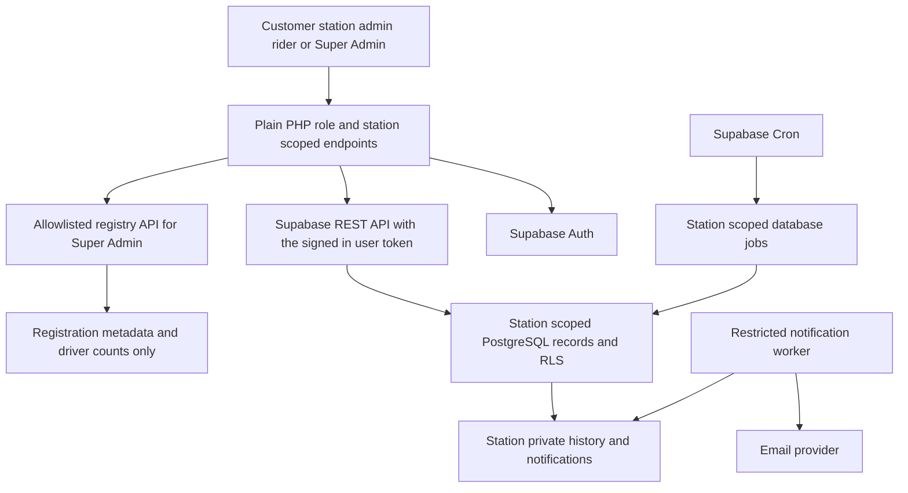

# DESIGN AND DEVELOPMENT OF A WEB-BASED ORDERING AND DELIVERY MANAGEMENT SYSTEM USING AN ORDER PROCESSING ALGORITHM FOR WATER REILLING STATIONS IN HAMTIC, ANTIQUE

Development plan for plain PHP with Supabase and Vercel.

**Institution:** University of Antique – Hamtic Campus, Guintas, Hamtic, Antique.  
**Degree:** Bachelor of Science in Computer Science.  
**Researchers:** Tricia Mae P. Amado, Veronica Sariego, Jean Encarnacion, Faith Nicole Gain, and Angel Mae A. Labauan.

**Hosting:** Target one shared Vercel application and Supabase project. Use the pinned community PHP runtime and entry point in [deployment instructions](../../deployment.md), durable sessions, and Supabase Cron. The [starter structure](../../file-management.md) is already present; its separate-installation notes describe the earlier scope and must be revised during multi-station implementation.

> **For implementation:** Use `superpowers:executing-plans` to work through the tracked tasks in order. This document is the proposed development roadmap and system design for review before coding.

**Goal:** Build one responsive PHP, Vercel, and Supabase platform where multiple Hamtic water refilling stations register and manage their own schedules, drivers, orders, and private financial records, while Super Admin manages registration metadata without transaction access.

**Architecture:** PHP provides role-specific pages and station-scoped services. One Supabase project provides authentication, station memberships, isolated PostgreSQL records, and narrow registry endpoints. Database functions enforce atomic ordering, schedule changes, and dispatch; Super Admin receives registration metadata and safe driver counts only.

**Tech stack:** Plain PHP 8.4 or a newer supported compatible release (local development uses PHP 8.5), Composer, native PHP cURL, Supabase Auth, Supabase PostgreSQL, server-rendered PHP views, Tailwind CSS 4 compiled with its CLI, vanilla JavaScript, the browser Geolocation API, Leaflet with OpenStreetMap tiles for map pins, and PHP and Node test scripts (jsdom page tests and PGlite migration tests). Use Git when implementation begins.

**Product name:** The system is presented to users as **HydroRoute**. The thesis title stays as approved by the adviser.

**Prepared:** 1 November 2026, Asia/Manila.  
**Revised:** 2 November 2026 for shared station registration, schedules, and restricted Super Admin access.  
**Revised:** 14 November 2026 for the HydroRoute name, the station price list, distance-based delivery fees, rider distance tracking with SSTF stop sequencing, the customer–station inbox with reservations, and gaps found in the 14 November thesis draft.

## 1 Basis and decisions

The project initially contained two reference documents and no application code. A plain PHP starter now supplies the thesis title page, Vercel entry point, routing, environment configuration, and Supabase transport. This document plans the business modules; those modules are not implemented yet.

| Reference | How it is used |
| --- | --- |
| [Hamtic Water Delivery Blueprint](../../../Hamtic%20Water%20Delivery%20Blueprint.md) | Original ordering, priority queue, delivery, notification, and research requirements; extended by the multi-station requirements below. |
| [Word thesis](../../../FinalDesign-and-Development-of-a-Web-Based-Ordering-and-Delivery-Management-System-Using-an-Order-Processing-Algorithm-for-Water-Refilling-Stations-in-Hamtic-Antique.docx) | Research objectives, Hamtic scope, Agile methodology, evaluation procedure, and research reporting requirements. The project copy is the 1 November draft. The 14 November draft (kept outside the project, in Downloads) was reviewed for this revision; replace the project copy with it. |
| Station price list (14 November 2026) | Product prices, pack quantities, and the distance-based delivery fee rule in [M11](#m11-design-distance-tracking-delivery-fee-and-sstf). |

The current decisions from your instructions are:

- Use plain PHP, Vercel, and Supabase.
- Support registration of multiple water refilling stations in Hamtic in one shared platform.
- Give each station its own station admins, drivers, products, schedules, customers served, orders, payments, and reports.
- Let station admins set working hours, no-service days, maintenance periods, and temporary closures.
- Give Super Admin access to registration and directory management and safe station and driver registration counts.
- Prohibit Super Admin access to station orders, order counts, customer transaction histories, payments, cash collection, revenue, and financial reports.
- Charge a delivery fee that depends on the distance from the station to the delivery address. The system decides the fee; staff do not type it.
- Let the assigned rider see the kilometers from the station to each destination and record the measured distance, so the system can confirm the fee automatically.
- Order the stops of each delivery trip with the Shortest Seek Time First (SSTF) rule, which the 14 November thesis title names.
- Give customers an inbox and chat with the station admins of a station, for reservations and other matters.

This scope supersedes the earlier proposal for separate installations. One station can be the first pilot, but station separation must be implemented from the start and verified with at least two stations.

The blueprint's Laravel, Breeze, MySQL, and MariaDB suggestions are replaced by plain PHP, Supabase Auth, and PostgreSQL. Business values such as hours, quantity limits, vehicle capacities, and priority weights still require confirmation with participating stations.

### Current implementation state (14 November 2026)

| Area | State |
| --- | --- |
| User interface | Complete preview for all four roles with sample data, under the HydroRoute name and logo. Pages do not read from Supabase yet. |
| Catalogue and prices | Seven products from the station price list, defined in `app/UI/Products.php`: 18.9 L refill PHP 20, 9.5 L refill PHP 10, faucet jug refill PHP 20, new faucet jug with water PHP 190, and 350 ml, 500 ml, and 1 L bottled water boxes at PHP 220, 270, and 260. |
| Delivery fee | Live checkout (Phase 4) calculates the Haversine distance between the station and address pins in the database and picks the fee band from each station's versioned fee rules (D1: unrounded distance). On arrival the rider's GPS can lower the fee or open a review, never raise it (D2). Migration `20261120000100_orders_tracking.sql` must be applied first. |
| Messaging | Live inbox, chat with read cursors and a 20-per-minute limit, and reservations that become scheduled orders (Phase 7, `20261120000300_messages_reservations.sql`). Preview mode keeps the browser-only demo. |
| Fulfillment | Live ordering, priority queue (P = U + A + C), pickup collection, dispatch with SSTF stop order, rider arrival and results, cash and empties verification, and completion (Phases 4–6). |
| Supabase | Project linked. The foundation migration was applied on 14 November 2026 through the SQL Editor because the local network blocks direct database connections. REST access and row-level security were checked with the publishable key. The PHP client was fixed to trust the Windows certificate store. |
| Remaining | Phases 4–8 are built and tested locally on branch `feat/orders-dispatch-messaging`; their four migrations and the Cron schedule (`docs/station-jobs-cron.sql`) still have to be run in the SQL Editor, after the Phase 2–3 migrations. Road distance, refunds and multi-load trips stay out of scope. |

## 2 Shared platform for Hamtic stations

Use one PHP application and one Supabase project for the Hamtic platform, with station-scoped records and database-enforced access. Each registered station has a unique station ID and an approved administrator membership. A customer may choose among approved stations and maintain their own order history across them.

### Station registration

1. An authenticated applicant submits the station name, business contact, Hamtic address and barangay, and responsible administrator's registration details.
2. The registration remains pending while Super Admin checks the directory information. A pending station cannot accept orders.
3. Super Admin approves or rejects the registration with a reason. Approval atomically creates or activates the station and the applicant's station-admin membership.
4. The station admin sets products, service barangays, hours, closures, and drivers before accepting orders.
5. Super Admin may suspend, reactivate, or archive the registration with an audit reason. Never delete historical operational records as part of directory management.

Proposed approval-based registration is an implementation decision for this plan. Confirm the registration evidence and moderation procedure during requirements gathering; do not assume every physical station has already registered.

### Separate registration and operating statuses

| Status group | Examples | Managed by | Effect |
| --- | --- | --- | --- |
| Registration | Pending, approved, rejected, suspended, archived | Super Admin | Determines platform eligibility and whether new business is allowed |
| Operating availability | Open, outside business hours, maintenance, no operations, temporarily closed | That station's admin and schedule rules | Determines which requested service times the station can accept |

Approval does not force a station to be open. Closing for maintenance does not reject or delete its registration. Public directory pages show each approved station's current availability and next reopening time when known.

Super Admin manages registration metadata and safe directory statistics. The role cannot open station operational screens, impersonate a station admin, or obtain private reports.

## 3 Scope and modules

### Modules included in this version

| Module | Purpose | Primary users |
| --- | --- | --- |
| M1 Accounts and access | Supabase login, verification, recovery, protected roles, station membership, and safe station switching | All roles |
| M2 Station registration and approval | Applications, approval or rejection, activation, suspension, and registration audit | Applicant and Super Admin |
| M3 Station directory and profiles | Hamtic station search, public contacts, served barangays, and displayed availability | Customers; owners manage their own profile |
| M4 Station schedules and availability | Weekly hours, service cutoffs, no-service days, maintenance, temporary closure, and reopening | Station admin |
| M5 Customer ordering | Addresses with a map pin, station selection, product selection, delivery or pickup, delivery fee quote, COD, duplicate checks, cancellation, and own history | Customer |
| M6 Order processing algorithm | Per-station validation, weighted priority, preparation queue, scheduled release, barangay batching, and SSTF stop sequencing | Station admin |
| M7 Drivers and delivery | Station driver registration, capacity, trips, delivery results, cash, and empty-container counts | Station admin and assigned rider |
| M8 Tracking and notifications | Own order timeline, station-availability notices, in-app updates, and configured email | Relevant customer, station admin, and rider |
| M9 Station records and reports | Own customers served, orders, delivery records, payments, revenue, CSV, and print | That station's admin |
| M10 Super Admin registry dashboard | Station registrations, registration statuses, directory information, and registered or active driver counts | Super Admin |
| M11 Distance, delivery fee, and stop order | Station and address coordinates, distance calculation, distance-tier fee rules, rider GPS distance during active trips, automatic fee confirmation on arrival, and SSTF stop sequencing | Customer (fee quote), assigned rider, station admin |
| M12 Inbox, chat, and reservations | One conversation per customer and station, unread counts, topic tags, order links, reservation requests and responses, and new-message notices | Customer and that station's admins |

Audit records and access checks apply across all modules. M10 includes no orders, order-volume counts, sales graphs, payments, revenue, financial exports, or customer transaction records. Riders and Super Admin have no access to M12 conversations.

### M11 design: distance tracking, delivery fee, and SSTF

**Locations.** Each station saves a map pin (latitude and longitude) in its profile. A customer saves a pin for each delivery address, either by placing it on a Leaflet map or by tapping "Use my current location". An address without a pin cannot be used for delivery; pickup does not need one.

**Distance.** The database calculates the straight-line (Haversine) distance in kilometers between the station pin and the address pin, rounded to 0.1 km. Straight-line distance is used in the first version because it is free, testable, and needs no outside service. Confirm with the stations whether they accept it or need road distance; a routing service can replace the calculation later without changing the fee rules.

**Fee rules.** Each station keeps a versioned fee table. The initial table from the station price list is:

| Distance from station | Fee per delivery order |
| --- | --- |
| Under 1 km | PHP 5 |
| 1 km to 3 km | PHP 10 |
| Over 3 km | PHP 15 |

The fee is charged once per delivery order, including refill-only orders. Pickup orders pay no fee. Each station also sets a maximum delivery distance; addresses beyond it are rejected at checkout with a clear message. The proposed default is 10 km; confirm it with each station.

**Quote at checkout.** The customer sees the distance, the fee, and the total before submitting. `submit_order` recalculates both on the server and saves them on the order with the fee-rule version. A browser-supplied distance or fee is never trusted.

**Rider distance tracking.** While a trip is active, the rider's phone page uses the browser Geolocation API to show:

- the distance from the station to each stop,
- the live distance from the rider to the next stop, and
- the distance travelled on the trip so far.

The page sends a position about every 30 seconds or every 50 m, whichever comes first, and only while the trip is open. Geolocation needs HTTPS (localhost is allowed during development) and the rider's permission.

**Automatic fee confirmation.** When the rider taps "Arrived", the page sends the current position and its accuracy. The database calculates the distance from the station to that point and looks up the fee in the same rule version:

1. If the measured fee equals the quoted fee, nothing changes.
2. If the measured fee is lower, the system charges the lower fee automatically and shows the new amount to the rider and the customer.
3. If the measured fee is higher, the customer still pays the quoted fee. The order is flagged for station admin review, because the pin may be wrong. The customer is never charged more at the door without review.
4. If location permission is denied or accuracy is worse than 100 m, the quoted fee stands and the reason is recorded.

Confirm rules 2 and 3 with the stations before implementation.

**SSTF stop sequencing.** After the batch for a trip is chosen (Stage 4 in section 8), the system orders its stops with Shortest Seek Time First, which for deliveries means "nearest unvisited stop next":

1. Start at the station pin.
2. Choose the unvisited stop with the shortest distance from the current point. Break ties by higher priority score, then by order ID.
3. Move to that stop and repeat until all stops are ordered.

If a stop fails or the rider changes course, the page recalculates the remaining order from the rider's current position. Staff may pin one overdue order to the front with a recorded reason. SSTF is a greedy rule: it usually shortens a trip but does not guarantee the shortest possible route. State this in the thesis.

**Privacy.** Only the assigned rider and that station's admins see rider positions. Positions are collected only during an active trip, never shown to customers as a live map in this version, kept for 30 days, then deleted; the measured distance stays on the delivery attempt. Super Admin receives no location data.

### M12 design: inbox, chat, and reservations

**Inbox.** Each customer has one conversation per station, and each station admin sees one conversation per customer who contacted that station. The inbox lists conversations with the last message, time, and unread count, and supports search and filters by topic and unread state. The existing preview pages at `/customer/messages` and `/station-admin/messages` become the live pages.

**Messages.** Text only in the first version, up to 2,000 characters, saved as plain text and always displayed escaped. Each message can carry a topic tag (General, Reservation, Order, or Delivery) and an optional link to one of the customer's orders at that station. Limit each user to 20 messages per minute. Attachments, voice, and online or typing indicators are outside this version.

**Delivery of new messages.** The browser checks a PHP endpoint for new messages every 10 seconds while a conversation is open, and every 60 seconds for the unread badge on other pages. Polling keeps Supabase tokens on the server, as section 5 requires. Supabase Realtime can replace polling later if tokens are handled safely.

**When the station is closed.** The conversation shows the station's availability notice and next opening time, so customers know replies may be delayed.

**Reservations.** A reservation is a request that needs the station's agreement before it becomes an order, for example a date more than seven days ahead, a quantity above the normal order limit, or an event delivery. The customer fills a short form inside the chat (date and time, delivery or pickup, products and quantities, address, note). It appears in the conversation as a reservation card.

| Reservation status | Meaning |
| --- | --- |
| requested | Waiting for the station |
| accepted | The station agreed; the system created a scheduled order |
| declined | The station refused, with a reason |
| cancelled | The customer withdrew before the order was prepared |
| expired | The requested time passed without a response |

The station admin can accept, decline with a reason, or reply in the chat to suggest changes; the customer then submits a revised request. Accepting runs one database function that rechecks station availability for that date, prices the products, calculates the delivery fee, creates the order as `scheduled`, links it to the reservation, and posts a system message. The order then follows the normal algorithm when released. A reservation never bypasses validation, capacity limits, or closures.

**Notifications.** A new message or reservation decision creates an in-app notification for the other party. Email for messages is optional and configured per station later.

### Features outside this version

Online payment gateways, live map tracking for customers, guaranteed shortest-route optimization, turn-by-turn navigation, road-distance routing services, chat attachments, SMS, credit accounts, container deposits, full inventory, accounting, native mobile apps, and nationwide operations remain outside scope. Multi-station registration within Hamtic, rider GPS distance during active trips, and SSTF stop ordering are included now.

The platform does not transfer orders, customers' payments, or driver assignments between stations automatically. Empty-container counts do not constitute a full inventory ledger. Hosted Supabase requires an internet connection; failed or uncertain writes need safe retry behavior.

## 4 Roles and pages

Four application roles are required. Station roles are memberships scoped to a specific station; Super Admin is a separate protected platform role.

| Role | Main pages | Allowed actions and limits |
| --- | --- | --- |
| Customer | Hamtic station directory, station catalog, own dashboard, order form, timeline, history, addresses with map pins, inbox and chat, reservations, profile | Choose an eligible station, see the delivery fee before ordering, place and track own orders, chat with and send reservation requests to a station, confirm an intentional repeat, cancel before preparation; cannot see other customers' orders or conversations |
| Station admin | Own station dashboard, profile and map pin, schedule calendar, maintenance and closures, products, delivery fee rules, customers served, drivers, queue, dispatch, inbox and reservations, payments, reports | Manage the station for which an active admin membership exists; view that station's orders, conversations, and revenue only; review fee mismatches flagged on arrival |
| Rider or driver | Own station membership, assigned trip with SSTF stop order, distance to each stop, live distance to the next stop, stop details, delivery forms, own history | Work on assigned stops only; share location only during an active trip; record arrival, cash, and empties without access to general station revenue, conversations, or other riders' trips |
| Super Admin | Registration queue, station registry, directory metadata, station approval status, driver registration counts, platform registration audit | Approve and maintain registrations and view safe counts; no access to orders, payments, revenue, operational reports, conversations, rider locations, or station customer histories |

A user with more than one approved station-admin membership must explicitly select the active station. Every request rechecks that membership; choosing a station in a dropdown does not grant access.

Super Admin accounts cannot also receive station-admin or rider memberships, use customer ordering functions, impersonate users, or reset an owner's password to obtain transaction access. Provision and change platform roles through a separately protected procedure; Super Admin cannot promote itself into an operational role.

Public pages show approved station profiles, public catalogs, hours, and availability. Private customer details and registration evidence are not public.

Important interface requirements:

- Show a clear station name on every customer order, staff queue, rider trip, notification, and report.
- Display Open, Closed, Under Maintenance, No Operations, or Temporarily Closed with the next opening when known.
- If no station is accepting the requested service time, show an empty state with available later times; do not show a broken order form.
- Show U, A, C, priority, and queue explanation only within the selected station's operational screens.
- Label queue position as a changing estimate, not a delivery-time guarantee.
- Give riders readable phone layouts and confirmation before delivery submission.
- Display success only after the server confirms the saved result.
- Show the distance, delivery fee, and total on checkout before submission, and the fee as a separate line on every order, receipt, and rider stop.
- Explain to riders why location permission is needed, and keep the trip usable when permission is denied.
- Show unread message counts in the navigation for customers and station admins.

### Station schedules maintenance and no-service days

Station admins can set:

1. Weekly opening and closing windows, including regular rest days. Support separate windows for a lunch break; split overnight opening into windows on adjacent days in the first version.
2. Daily order or delivery cutoffs, constrained to the station's service windows.
3. Date-specific no-service periods such as a holiday, no operations today, or no available personnel.
4. Planned maintenance with a start, end, and customer-facing notice.
5. An immediate temporary closure or maintenance override, with an optional end time. An override without an end remains closed until explicitly reopened.
6. Reopening and a preview of the next seven days customers can book.

Use Asia/Manila for local dates and hours. Require a valid time range, reject overlapping contradictory entries, and keep a history of who changed availability.

Evaluate availability in this order: registration eligibility, active closure or manual override, weekly service windows, then the requested service time and cutoff. Check the actual current time in database operations; reopening must not depend on a browser refresh or a late cron job.

ASAP orders require the station to be open now. Future orders are allowed only within valid future service windows. A station closed now may accept a future order after a known reopening; an indefinite maintenance or no-operations override blocks new bookings until it is cleared.

When closure affects existing orders, retain them, flag the affected orders for that station admin's review, pause new preparation or dispatch during the closure, notify affected customers, and offer rescheduling or an allowed cancellation. Never silently transfer an order to another station. Already dispatched riders can record outcomes, and admins can reconcile existing payments even while the station is closed or suspended.

Super Admin can see the public availability label and schedule metadata in the registry, but cannot inspect affected orders, their number, their value, or closure notifications containing transaction details.

## 5 Application architecture



Use a small MVC structure: routes select controllers, controllers call services, repositories talk to Supabase, and PHP views render HTML. Keep HTML, network calls, and business decisions in separate files.

PHP can call Supabase's REST endpoints directly; it does not require a JavaScript frontend framework. Data endpoints are under `/rest/v1`, and database functions can be called through RPC routes. See [Supabase API routes](https://supabase.com/docs/guides/api/creating-routes).

### Authentication and sessions

Use Supabase Auth as the only password authority. The application profile references the Supabase user UUID and contains no password hash.

Provision the profile through a controlled Auth-user creation trigger or equivalent protected setup, always defaulting public registrations to customer. Make profile creation idempotent. Allow self-service edits only to ordinary contact fields. Protect the last active admin for each approved station and the last platform admin separately; station admins cannot change platform roles.

PHP sends registration, login, refresh, verification, recovery, and logout requests to the Auth API. Store access and refresh tokens in a protected durable server-side session store compatible with separate Vercel instances; do not rely on local PHP session files. The browser receives an opaque session cookie with Secure in production, HttpOnly, and SameSite protection. Regenerate the session identifier after login and serialize refresh operations to avoid competing token updates. See the [Auth API](https://github.com/supabase/auth) and [session guide](https://supabase.com/docs/guides/auth/sessions).

Configure verification and recovery emails to use a server-readable confirmation token or code flow. Test callbacks end to end; a PHP server cannot read URL fragments. Clear application sessions on logout and handle expired or revoked sessions without a redirect loop.

### Supabase requests

- Ordinary user requests use the publishable API key and the user's access token.
- Restrict any secret key to provisioning or background operations that require it; keep it outside the document root and source control. Secret keys bypass RLS. See [Supabase API keys](https://supabase.com/docs/guides/getting-started/api-keys).
- Use one HTTP client wrapper for headers, JSON, timeouts, safe errors, and correlation identifiers.
- Never log passwords, access tokens, refresh tokens, or secret keys.
- Reuse idempotency keys when retrying a mutation whose outcome is uncertain.

### Atomic operations

Submitting an order must save the order, its items, initial history, and notification event together. Dispatch must reserve a rider and orders together. Recording a delivery must save its attempt, cash record, status, and history together. Separate HTTP inserts are not one transaction; use a database function for each workflow. See [Supabase database functions](https://supabase.com/docs/guides/database/functions).

Revoke direct writes to workflow-controlled tables from ordinary authenticated API clients, including administrators using the application. Expose only the necessary RPC entry points. Prefer invoker functions; where restricted writes require elevated execution, use a reviewed wrapper with explicit actor and role checks, a fixed search path, a limited owner, and explicit execution grants. Keep privileged helpers in a non-exposed schema. Calls to an email provider happen after the database transaction commits.

## 6 Database plan

This is a proposed logical schema, not an applied migration. Use UUIDs for identities and entities, timestamptz for instants, date for service dates, integer quantities, and numeric(12,2) for money. Determine local schedules and service dates in Asia/Manila.

| Table | Purpose and important fields |
| --- | --- |
| auth.users | Supabase-managed identities; never recreate password storage |
| profiles | Shared identity and own contact fields; no user-editable global station role |
| private.platform_admins | Protected Super Admin identities; no public signup or self-promotion |
| station_registration_requests | Applicant, Hamtic station details, review status, reviewing actor, and reason; no orders or financial records |
| stations | Station ID, name, public business contact, address, municipality, latitude and longitude pin, registration status, and directory fields |
| station_memberships | Station ID, user ID, station_admin or rider role, membership status, and audit identity |
| barangays | Reference list of Hamtic barangays |
| station_service_areas | Station ID and barangay ID; served flag |
| station_settings | One record per station: cutoffs, quantity limit, maximum delivery distance, algorithm weights, rule version, and settings version |
| delivery_fee_rules | Station ID, rule version, distance bands (minimum km, maximum km, fee), effective time, and creating admin; earlier versions stay for history |
| station_opening_hours | Station ID, weekday, service window start and end, and enabled flag |
| station_closures | Station ID, start and end, maintenance or no-operations reason, public notice, and creating admin |
| station_availability | Station ID, normal or manual closure mode, effective time, optional expiry, public notice, and record version |
| customer_addresses | Shared customer's own saved addresses with barangay, landmark, latitude and longitude pin, and pin source (map or device location); not a platform directory for Super Admin |
| customer_station_profiles | Station ID and customer ID, station-specific institution classification and service restrictions; does not authorize editing global identities |
| products | Station ID, product name, pack quantity (for example "1 box for 40 pcs"), unit price, whether an empty container is exchanged, load units, and availability |
| orders | Station ID, customer, fulfillment (delivery or pickup), snapshots, service time, quantities, items subtotal, quoted distance, quoted delivery fee, fee-rule version, final delivery fee, total, status, queue times, availability review flag, duplicate marker, score components, idempotency key, and versions |
| order_items | Station ID, order, product, name and price snapshots, quantity, and line total |
| order_status_logs | Station ID, order, prior and next status, actor, reason, and time |
| riders | Station ID, rider membership and user ID, vehicle details, capacity, availability, and enabled flag |
| delivery_trips | Station ID, rider, capacity snapshot, load, status, dispatch and return times, and version |
| trip_orders | Station ID, trip, order, SSTF sequence, leg distance, manual-reorder reason, and active assignment state; preserve previous assignments |
| rider_locations | Station ID, trip, rider, latitude, longitude, accuracy, and recorded time; written only during an active trip and deleted after 30 days |
| delivery_attempts | Station ID, assigned stop, outcome, failure reason, empties, arrival latitude and longitude, GPS accuracy, measured distance, fee decision (unchanged, lowered, flagged, or fallback), actor, time, and idempotency key |
| payments | Station ID, order and attempt, applied amount, tendered cash, change, reconciliation state, and verifying station admin |
| conversations | Station ID, customer, optional linked order, and created time; one conversation per customer and station (already in the applied migration) |
| messages | Conversation, sender, body (plain text, up to 2,000 characters), kind (text, reservation card, or system), topic tag, optional order link, and created time |
| read_receipts | Conversation, user, and last read time (already in the applied migration) |
| reservations | Station ID, customer, conversation, requested service time, fulfillment, address, note, status, decision reason, deciding admin, created order, and version |
| reservation_items | Station ID, reservation, product, and quantity; prices are taken only when the reservation is accepted |
| notifications | Station ID, operational event, intended recipient, order, channel, read or send state, and retry state; unavailable to Super Admin |
| station_audit_events | Station-scoped business changes including schedules, attempts, payment verification, and role changes; unavailable to Super Admin |
| platform_notifications | Registration and directory messages only; no embedded transaction data |
| platform_audit_events | Registration approvals, registry edits, and suspensions only; safe for Super Admin |

Data integrity rules:

- Every business record must carry a non-null station_id. Shared identities, own addresses, and the barangay reference list are explicitly global exceptions.
- Use composite foreign keys such as (station_id, order_id) and (station_id, product_id) to prevent links between different stations. A globally unique UUID alone does not prove the relationship belongs to the caller's station.
- Validate active station membership on every operational request. Never authorize from a browser-supplied station ID alone.
- Scope settings, institution classification, duplicate checks, queue scores, rider counts, reports, and service coverage to the station.
- Make (station_id, customer_id, idempotency_key) unique for submissions and (station_id, order_no) unique for displayed order numbers.
- Prevent an order from having multiple active trip assignments and a driver from having simultaneous active trips, including across station memberships.
- Preserve order address, product, and price snapshots; calculate amounts from the selected station's trusted product data.
- Index station membership lookups and frequently filtered (station_id, status, service_date), (station_id, customer_id), trip, log, notification, and foreign-key columns.
- Keep registration metadata separate from operational data. Do not copy revenue or order totals into stations, platform audit records, or registry responses.
- Disable or archive records when appropriate; preserve historical transactions and audit trails.
- Calculate distance and delivery fee only in the database from saved pins and the station's active fee-rule version. Store money in centavos as integers in new tables to match the applied migration, or switch the whole schema to numeric(12,2); do not mix both.

### Gaps between the applied migration and this plan

The foundation migration applied on 14 November 2026 covers identities, roles, memberships, stations, addresses, products, minimal orders and items, conversations, messages, and read receipts with row-level security. The next migrations must add:

1. Order statuses `scheduled`, `on_hold`, and `completed`. The applied check constraint allows only pending, confirmed, preparing, ready, out_for_delivery, delivered, and cancelled for delivery, and collected for pickup.
2. Order money and distance columns: items subtotal, quoted distance, quoted and final delivery fee, fee-rule version, and total.
3. Station and address pins, station settings, and `delivery_fee_rules`.
4. Trips, stops with SSTF sequence, rider locations, delivery attempts, and payments.
5. Message kind, topic tag, and order link; `reservations` and `reservation_items`; and RPCs to start a conversation and to accept or decline a reservation. Customers cannot insert conversations directly today.
6. Order status logs, notifications, schedules, closures, and audit tables.

## 7 Permissions and station privacy

Super Admin is an application registry role, not a database superuser. It has narrower access to station operations than a station admin. The application must not grant access to private records just because a user is Super Admin.

| Data or action | Customer | Assigned rider | Station admin | Super Admin |
| --- | --- | --- | --- | --- |
| Approved station directory and public availability | Read | Read | Read; edit own station through approved operations | Manage registry metadata |
| Station registration request | Submit and track own application | Own application if applicable | Track own station application | Review, approve, reject, suspend, reactivate, archive |
| Weekly hours and operational closures | Read public schedule | Read own station schedule | Set own station schedule and closure | Read directory schedule metadata only |
| Registered and active driver counts | No private registry view | No platform view | Own station count | Per-station and platform registration counts |
| Driver registration and assignment | No | Own membership | Manage own station drivers | Counts only; no trips or collection details |
| Customer addresses and contact records | Own permitted fields | Assigned-stop contact details only | Contacts necessary for own station orders | No customer address directory |
| Orders, items, order counts, and status history | Own orders | Assigned stops only | Own station only | Denied, including aggregates |
| Preparation, dispatch, and reattempt approval | No | Delivery result on assigned stop only | Own station only | Denied |
| Payments, cash, revenue, and financial reports | Own payment summary | Collection entry for assigned stop | Own station only | Denied, including exports and aggregates |
| Algorithm settings, operational logs, and reports | No | Own delivery history only | Own station only | Denied |
| Delivery fee rules and maximum distance | Read the fee for own quote | Read fee on assigned stops | Set own station rules | Denied |
| Rider live and arrival locations | No | Own positions during an active trip | Own station's active and recent trips | Denied |
| Conversations, messages, and read receipts | Own conversations with stations | Denied | Own station's conversations | Denied |
| Reservations | Create, read, and cancel own | Denied | Accept or decline own station's | Denied |
| Notifications and audit | Own relevant operational notices | Own relevant notices | Own station operations | Registration notices and platform audit only |

### Super Admin dashboard allowlist

Permit only station registration ID, station name, public contact and address, responsible registration contact, registration date and status, public hours and availability, and counts of registered or enabled drivers. Registered drivers means distinct driver users with an accepted, non-archived registration at that station, including inactive registrations. Active drivers means those with an enabled rider record and active membership; it does not mean drivers currently on a trip. A platform total of unique driver identities must be labeled separately from per-station membership counts to avoid double counting.

Prohibit order counts, order amounts, order identifiers, customer purchase histories, payment totals, cash balances, revenue charts, sales rankings, and links to operational dashboards. Count drivers from membership or rider registration data, never from deliveries or payments.

Build a dedicated registry API with an explicit field allowlist. Do not fetch full operational rows and hide financial columns in HTML. Restrict filters, sorting, downloads, audit entries, and error messages to the same safe fields.

### Enforce the boundary in Supabase and PHP

- Enable RLS and explicit grants on exposed objects. A station admin's permissions require an active membership matching the row's station_id.
- Transaction access also requires that the identity is not a platform Super Admin. Do not add a universal is_super_admin permission branch.
- Prevent platform admins from creating station memberships for themselves, joining a station via an invitation, impersonating a customer, or using password-reset administration to bypass the boundary.
- Derive roles from protected records, never user-editable metadata or a request parameter. Recheck protected membership and platform status when privileges change.
- Apply equivalent checks to child records, joins, RPCs, views, notifications, CSV or print routes, cached reports, and any future Realtime or Storage access.
- Review views and elevated functions for bypasses; expose only narrow, actor-checked operations. Ordinary station and Super Admin requests use user-scoped tokens, not a secret key that bypasses RLS.
- Keep operational worker credentials separate from registry routes. Supabase infrastructure ownership and deployment secrets belong to trusted infrastructure operators, not the Super Admin web role.
- Key caches and background work by station and authorization context. Job output delivered to Super Admin must contain registration data only.
- Log attempted access violations without including private records in platform-visible logs.

Use CSRF protection, escaped HTML, rate limiting, safe error messages, controlled callback destinations, and ownership-preserving updates. Test allow and deny behavior through direct REST/RPC calls as well as PHP pages. See [Supabase RLS](https://supabase.com/docs/guides/database/postgres/row-level-security) and [API security](https://supabase.com/docs/guides/api/securing-your-api).

## 8 Order processing rules

### Stage 1 Validate and classify

Run every stage within one selected station. Resolve station membership and parent-child ownership from trusted records; Super Admin cannot call transactional operations. Check current station registration and availability before accepting an order or dispatching.

Implement the blueprint's V1 to V7 with these explicit interpretations:

1. Require an authenticated active customer, an approved selected station, valid service availability, valid phone, products belonging to that station, integer quantities, an owned address, and a delivery choice.
2. Normalize Philippine phone numbers to a consistent stored format. Accept `09XXXXXXXXX` and the equivalent `+639XXXXXXXXX`; reject malformed input.
3. Start with a proposed maximum of 20 containers for the whole order, not 20 for each line. Confirm the actual limit with the station.
4. Require a barangay served by the selected station and an active address owned by the customer.
5. Treat ASAP as immediate demand during service hours. For scheduled delivery, require a future valid service time within the station's hours and cutoffs.
6. Allow scheduled service dates through seven calendar days ahead only within that station's weekly hours, dated closures, maintenance overrides, and valid cutoffs.
7. Flag a possible duplicate within the same station when the same customer submits the same normalized products and quantities, address, and requested schedule while a matching active order was created within the preceding 30 minutes. Show the original order and ask whether the repeat was intentional.
8. For delivery, require an address pin and a distance within the station's maximum delivery distance. Calculate the distance and fee on the server with the active fee-rule version and save them on the order. Pickup orders skip this check and pay no fee.

Invalid form data returns field-specific errors without creating a live order. The blueprint's Returned label can be represented as the validation outcome; storing invalid live orders is unnecessary for the first version.

Persist valid possible duplicates as `on_hold`. Confirming one releases it after the business checks run again, with an audited duplicate override. Do not send it through duplicate detection indefinitely. Declining it cancels it.

Future-day orders become `scheduled`. Release them at that station's valid opening on the requested service day only if no closure or suspension blocks service. Flag closure-affected orders for rescheduling review. On job recovery, recheck current eligibility, flag missed times, and notify only that station's responsible staff and affected customers.

### Stage 2 Compute priority

Use the blueprint's initial formula:

`P = U + A + C`

| Component | Proposed calculation |
| --- | --- |
| U urgency | ASAP, overdue, or due within 60 minutes: 40; due after 60 and within 180 minutes: 25; later today: 10 |
| A aging | 5 points for every full 10 minutes since entering the active queue, capped at 25 |
| C customer classification | Household: 0; institution bonus: 10 only if enabled by that station, using its own customer classification; leave disabled otherwise |

For future-day orders, begin aging when released to the active queue, rather than counting several days of advance booking as active waiting. Save `queued_at` separately from `created_at`. For an approved reattempt, reset `queued_at` to the approval time; preserve the original times in history. No aging accumulates while redispatch is paused.

Use one authoritative database scoring function and pass a fixed evaluation time in tests. Production RPCs obtain the current time from the database, rather than accepting a customer-supplied scoring time. PHP's priority service invokes the queue operation and renders its result. Avoid maintaining two independent formulas in PHP and SQL.

### Stage 3 Build the queue

- Maintain separate preparation and dispatch queues for each station. Exclude closure-affected work awaiting review; never rank or combine orders across stations.
- Sort each queue by priority descending, then `queued_at`, `created_at`, and order ID ascending for deterministic ties.
- Recompute every five minutes and when submission, release, duplicate confirmation, readiness, or an approved rule change affects the queue. Use current scores when dispatching.
- Display in-progress preparation separately. A new urgent order does not interrupt an order already being prepared.
- Save the scoring timestamp, components, and rule version used for decisions.
- Alert staff when an order is overdue or has waited beyond a proposed 120-minute operational threshold. Staff must acknowledge and resolve these cases with a reason.

**Correction to the blueprint:** Capped aging improves priority but does not prove starvation cannot happen under continuous higher-priority arrivals. Keep this limitation in the thesis. If the station requires a maximum-wait override, define and test it as a separate approved ordering rule before claiming a fairness guarantee.

### Stage 4 Batch and assign

1. Require that the selected station is eligible and currently operating. Identify its free, enabled riders with active memberships and their actual vehicle capacities. Count trips dispatched today in Asia/Manila; use rider ID as the final tie breaker.
2. Select ready orders that are ASAP or due within 60 minutes and are not paused for a failed-attempt review.
3. Start with the highest-priority eligible order. Select the free rider with the fewest dispatched trips who can carry the entire order.
4. Add compatible orders from the same station and barangay, in queue order, while staying within that vehicle's capacity.
5. Order the selected stops with SSTF from the station pin (see [M11](#m11-design-distance-tracking-delivery-fee-and-sstf)) and save each stop's sequence and leg distance.
6. Save the trip, its stops, rider reservation, order transitions, and notifications in one transaction.
7. Require staff confirmation of the proposed trip before dispatch. Then set the assigned orders to `out_for_delivery`.
8. Release the rider only after the trip's stops have resolved and the rider confirms returning or staff closes the trip. A failed attempt alone does not make the rider free.

**Capacity correction:** Never dispatch a 20-container order on a 15-container vehicle. Keep it ready with a visible capacity issue and require a suitable vehicle or an approved order revision. Multiple-load and partial-delivery handling is a later feature. If no free vehicle fits the highest-priority order, flag it and consider the next feasible order without hiding the capacity issue.

Priority decides which orders join a trip; SSTF decides the order in which the rider visits them. Barangay grouping and SSTF shorten trips but do not guarantee the shortest road route. Staff may move one overdue stop to the front with a recorded reason.

**Thesis note:** The 14 November thesis title names the SSTF algorithm, while its abstract and Chapter III describe only a general order processing algorithm. This plan uses the priority formula for the preparation and dispatch queues and SSTF for stop sequencing. Confirm this division with the adviser, then describe both consistently in the manuscript.

## 9 Order status and delivery outcomes

Normal flow:

`confirmed -> preparing -> ready -> out_for_delivery -> delivered -> completed`

Additional flows:

- `on_hold -> confirmed` or `scheduled` after intentional-duplicate confirmation.
- `on_hold -> cancelled` when the customer declines the repeat.
- `scheduled -> confirmed` when its service day opens.
- `confirmed`, `scheduled`, or `on_hold -> cancelled` before preparation begins.
- `out_for_delivery -> ready` after a failed attempt, with redispatch paused until staff review.
- Pickup: `confirmed -> preparing -> ready -> collected -> completed`. Pickup orders never enter dispatch and pay no delivery fee.
- Reservation: `requested -> accepted` creates a `scheduled` order; `requested -> declined`, `cancelled`, or `expired` creates no order.

On arrival, the delivery fee is confirmed or adjusted by the rules in [M11](#m11-design-distance-tracking-delivery-fee-and-sstf). The amount the rider collects is the items subtotal plus the final delivery fee. A flagged higher measured fee does not change the amount collected; the station admin reviews it before completing the order.

Proposed operational exception for station review: an administrator may cancel a ready order that cannot be fulfilled, including an unresolved failed attempt, only when it has no active trip assignment or applied payment. Require a reason and retain all attempt records. Delivered or completed orders do not use this cancellation path.

`pending` can be a short submission-processing state if needed internally. It must never appear as a successful order before the atomic submission completes. Invalid input remains a form validation result.

Only the rider assigned to an active stop can record its result. A failed attempt requires a reason such as customer unavailable, address issue, or access problem. Save the original attempt, notify the customer, and require staff review before trying again. Do not immediately dispatch the same unreachable customer repeatedly.

For successful COD delivery, record amount applied to the order separately from cash tendered and change. For example, a PHP 90 order paid with PHP 100 has PHP 90 applied and PHP 10 change. Successful delivery normally requires full payment; exceptions need an explicit admin resolution. Do not add credit-account behavior implicitly.

The rider marks `delivered`. The administrator verifies cash and empties and marks `completed`. Store collected cash, verified payments, and completed-order totals as separate report measures to avoid double counting or treating unverified cash as reconciled sales.

Every transition records station_id, prior status, next status, actor or station-scoped system job, timestamp, and reason. Use optimistic record versions or row locks to reject stale changes. Registration and station operating statuses are separate from order status; closures pause or flag affected work without erasing its history. Super Admin cannot inspect this history.

## 10 Proposed project structure

The following tree describes the target application structure. The starter implements the foundation and reserves module folders; consult [file management](../../file-management.md) for the files that currently exist. Add the remaining files as their modules are implemented.

```text
public/
  index.php                    Single HTTP entry point
  assets/css/app.css           Shared responsive styles
  assets/js/orders.js          Order form and safe submission behavior
  assets/js/tracking.js        Timeline and notification polling
  assets/js/rider.js           Rider actions and retry feedback
  assets/js/rider-gps.js       Geolocation during active trips, distance display, arrival
  assets/js/map-pin.js         Leaflet pin picker for station and address locations
  assets/js/messages.js        Inbox, chat polling, and reservation cards (preview exists)
app/
  Core/Router.php              Route matching
  Core/Request.php             Input parsing
  Core/Response.php            HTML JSON and redirects
  Core/Session.php             Server session lifecycle
  Core/Csrf.php                CSRF generation and validation
  Middleware/AuthMiddleware.php
  Middleware/RoleMiddleware.php
  Middleware/StationContextMiddleware.php
  Middleware/PlatformRegistryMiddleware.php
  Controllers/AuthController.php
  Controllers/CustomerController.php
  Controllers/OrderController.php
  Controllers/AdminController.php
  Controllers/DispatchController.php
  Controllers/RiderController.php
  Controllers/ReportController.php
  Controllers/SettingsController.php
  Controllers/StationRegistrationController.php
  Controllers/StationDirectoryController.php
  Controllers/StationScheduleController.php
  Controllers/SuperAdminController.php
  Controllers/MessageController.php
  Controllers/ReservationController.php
  Services/SupabaseClient.php   HTTP transport and error mapping
  Services/AuthService.php     Auth API and token lifecycle
  Services/OrderService.php    Order validation and workflow RPCs
  Services/PriorityService.php Queue queries and score explanations
  Services/DispatchService.php Trip preview and atomic dispatch
  Services/DeliveryService.php Attempt and collection workflows
  Services/NotificationService.php
  Services/ReportService.php
  Services/StationRegistrationService.php
  Services/StationAvailabilityService.php
  Services/PlatformRegistryService.php
  Services/DeliveryFeeService.php  Fee quotes and rule versions (calls database functions)
  Services/RouteService.php    SSTF stop order and rider location records
  Services/MessagingService.php
  Services/ReservationService.php
  Repositories/                Small REST and RPC access classes
  Views/auth/                  Login registration recovery verification
  Views/customer/              Dashboard orders addresses and profile
  Views/admin/                 Queue dispatch catalog reports settings
  Views/rider/                 Trips stop details and delivery forms
  Views/stations/              Directory registration and public availability
  Views/admin/schedules/       Own station hours maintenance and closures
  Views/superadmin/            Safe registration registry and driver counts
  Views/layouts/               Shared templates
config/app.php                 Environment-backed configuration
bootstrap.php                  Composer config and service setup
routes/web.php                 Explicit method path and role map
supabase/functions/            Restricted hosted notification worker
supabase/jobs/                 Planned station scoped Cron definitions
supabase/migrations/           Schema grants policies and functions
supabase/tests/                Database permission and workflow tests
supabase/seed.sql              Clearly fictional development fixtures
tests/Unit/                    Input and presentation calculations
tests/Integration/             Auth API and database workflows
tests/Acceptance/              Role-based scenarios and evidence
storage/                       Local scratch only never production sessions
docs/requirements.md
docs/algorithm-rules.md
docs/database-design.md
docs/test-evidence.md
docs/deployment.md
composer.json
composer.lock
.env.example                   Variable names without credentials
.gitignore
```

For local development, use the public entry point and router. Vercel uses api/index.php with explicit application routing. Keep environment values and internal records private, use durable shared sessions and provider logging, and do not expose deployment or database tools in the Super Admin UI. The additional controllers, middleware, and views above are planned files, not already implemented modules.

## 11 Interfaces between PHP and the database

Use a documented JSON result with ok, data, error_code, and field errors where applicable. Map invalid input to 422, unauthenticated requests to 401, forbidden actions to 403, and state conflicts to 409. Network errors must not imply a write definitely failed.

Every operational function validates the authenticated actor, the target station or parent record, station membership where required, and the Super Admin prohibition. Every list and report takes an explicit station ID and rechecks authorization.

| Operation | Inputs and output contract |
| --- | --- |
| register_station(payload, request_key) | Authenticated non-platform applicant; saves a pending registration and returns only their registration result |
| review_station_registration(registration_id, decision, reason, expected_version) | Super Admin; approves or rejects directory registration and returns safe registry fields only |
| update_station_registration(station_id, action, reason, expected_version) | Super Admin; suspend, reactivate, archive, or maintain approved metadata; no order IDs, affected-order counts, or transaction data returned |
| get_platform_station_registry(filters) | Super Admin; allowlisted registry metadata and driver registration counts only; disallow operational filters |
| get_station_availability(station_id, requested_at) | Public approved-directory operation; returns effective availability, next valid service window, and public notice |
| save_station_hours(station_id, windows, cutoffs, expected_version) | Own station admin; validates service windows and returns revised schedule |
| set_station_closure(station_id, interval, mode, public_notice, expected_version) | Own station admin; saves dated closure or immediate override, flags affected orders, and records notices atomically |
| reopen_station(station_id, expected_version) | Own station admin; clears manual override and returns availability based on remaining closures and weekly hours |
| submit_order(station_id, payload, request_key) | Customer; checks live station eligibility and requested service window, ownership, station products and prices; returns saved own order |
| confirm_duplicate(order_id, expected_version) | Owner; validates the order's station and current availability before releasing an intentional repeat |
| cancel_order(order_id, expected_version, reason) | Owner before preparation or own station admin under the documented operational exception |
| reschedule_order(order_id, requested_at, expected_version) | Owner before preparation or own station admin resolving a closure; validates that station's service windows, keeps history, and notifies the owner |
| start_preparation(order_id, expected_version) | Own station admin; checks current station availability and moves confirmed to preparing |
| mark_order_ready(order_id, expected_version) | Own station admin; records work already performed without bypassing dispatch restrictions |
| get_preparation_queue(station_id) | Own station admin; station-only candidates and priority explanations |
| preview_trip(station_id) | Own station admin; station-only feasible rider, orders, and current versions |
| dispatch_trip(station_id, rider_id, order_ids, request_key) | Own station admin; atomically checks same-station links, availability, rider reservation, priorities, capacity, barangay, and requested times |
| record_delivery(payload, request_key) | Assigned rider; derives station from the stop; permits results for already dispatched trips during station closure |
| approve_reattempt(order_id, expected_version, reason) | Own station admin; clears the redispatch pause only when an eligible station service time is available |
| complete_order(order_id, expected_version) | Own station admin; requires delivered and reconciled payment, including during closure |
| close_trip(trip_id, expected_version) | Assigned rider or own station admin; resolves stops and return confirmation and frees the driver |
| run_station_jobs(station_id) | Restricted operational worker; releases eligible schedules, checks closures, refreshes that station's scores, expires unanswered reservations, deletes rider locations older than 30 days, and records station-private job results |
| save_station_location(station_id, latitude, longitude, expected_version) | Own station admin; validates coordinates within Hamtic and returns the saved pin |
| save_delivery_fee_rules(station_id, bands, max_km, expected_version) | Own station admin; validates contiguous, non-overlapping bands and saves a new rule version |
| quote_delivery(station_id, address_id) | Owner of the address; returns distance, fee, rule version, and whether the address is within the maximum distance |
| get_trip_sequence(trip_id, from_latitude, from_longitude) | Assigned rider or own station admin; returns remaining stops in SSTF order from the given point |
| record_rider_location(trip_id, latitude, longitude, accuracy, request_key) | Assigned rider during an active trip only; rejects positions for closed trips |
| mark_arrived(stop_id, latitude, longitude, accuracy, request_key) | Assigned rider; saves measured distance and the fee decision (unchanged, lowered, flagged, or fallback) and returns the amount to collect |
| start_conversation(station_id) | Customer; returns the existing conversation for that station or creates one; approved stations only |
| send_message(conversation_id, body, topic, order_id, request_key) | Conversation participant other than riders and Super Admin; validates length, rate limit, and that a linked order belongs to the same customer and station |
| list_inbox(station_id or customer scope, filters, cursor) | Customer or own station admin; conversations with last message and unread count |
| get_messages(conversation_id, after) | Participant; returns messages newer than the given point for polling |
| mark_conversation_read(conversation_id) | Participant; updates the caller's read receipt |
| request_reservation(station_id, payload, request_key) | Customer; validates products, address, and requested time format, then posts a reservation card |
| respond_reservation(reservation_id, decision, reason, expected_version) | Own station admin; on accept, rechecks availability, prices items, calculates the fee, creates one scheduled order, and posts a system message atomically |
| cancel_reservation(reservation_id, expected_version) | Customer owner while requested, or under order cancellation rules after acceptance |

Use UUIDs for IDs and request keys, timestamptz for instants, integer record versions, and validated JSON objects or arrays for payloads. Never accept station membership, role, revenue, a computed price, a distance, or a delivery fee as authoritative payload fields.

Order submission, closure changes, and dispatch lock or version-check the same station availability record. If an order wins a race before closure is saved, the closure workflow flags it for review. If the closure wins first, the order or dispatch must revalidate and fail safely.

Save migrations in dependency order: registry and identities, memberships and schedules, business tables and composite constraints, grants and RLS, workflow functions, then fictional fixtures. Build the narrow platform registry query without exposing transactional functions.

## 12 Development phases and exit criteria

The earlier 14-week estimate covered one station. The expanded shared-platform scope, with distance-based fees, rider distance tracking, SSTF, and the inbox with reservations, is now a proposed ten-sprint, 20-week estimate including requirements and evaluation. Reconfirm timing after requirements review; this is not a committed delivery date.

### Sprint 0 Requirements and privacy rules Weeks 1 and 2

Files: docs/requirements.md, docs/algorithm-rules.md, docs/database-design.md, docs/access-matrix.md.

- [ ] Gather requirements from at least two participating Hamtic stations and record their different working hours and operating rules.
- [ ] Confirm registration approval evidence, Super Admin metadata fields, driver count definitions, and prohibited transaction access.
- [ ] Agree on closure, no-operations, rescheduling, cancellation, and already-dispatched delivery behavior.
- [ ] Confirm each station's COD, containers, quantities, capacities, and priority weights.
- [ ] Confirm the delivery fee bands, maximum delivery distance, straight-line versus road distance, and the lower-fee and flagged-higher-fee rules on arrival.
- [ ] Confirm what counts as a reservation (dates beyond seven days, large quantities, events) and how fast stations will answer messages.
- [ ] Confirm with the adviser that SSTF orders delivery stops while the priority formula orders the queues.
- [ ] Update use cases, context diagram, DFD, ERD, and evaluation tasks for four roles, messaging, reservations, and distance tracking.
- [ ] Review the privacy matrix and measurable acceptance targets with participants and the adviser.

Exit: Confirmed station rules, a registry field allowlist, and a reviewable separation-of-access specification.

### Sprint 1 Authentication and station isolation Weeks 3 and 4

Files: core authentication, station-context middleware, protected platform-role and membership migrations, Supabase policy tests.

- [ ] Reuse the existing PHP starter and implement verified login, recovery, and durable sessions.
- [ ] Add station identities, memberships, protected platform roles, and composite station relationships.
- [ ] Implement explicit station switching and per-request authorization.
- [ ] Provision the initial platform admin through a controlled setup process.
- [ ] Deny Super Admin access to transactional tables and operations, including an account with an injected station membership.
- [ ] Verify direct REST/RPC access with two station admins, one rider per station, customers, and a platform admin.

Exit: Accounts work and privacy is enforced before operational features are added.

### Sprint 2 Station registration and Super Admin registry Weeks 5 and 6

Files: StationRegistrationController, SuperAdminController, StationRegistrationService, PlatformRegistryService, registry views, registration migrations and tests.

- [ ] Build station application, pending review, approval or rejection, suspension, reactivation, and archive.
- [ ] Create owner membership only through the guarded approval operation.
- [ ] Build the Hamtic directory and safe Super Admin registry dashboard.
- [ ] Add registered and enabled driver counts from registration data only.
- [ ] Restrict registry responses, filters, exports, and audit to allowlisted metadata.
- [ ] Verify that Super Admin sees no orders, order counts, payments, or revenue.

Exit: Multiple stations can register in one system, and platform management exposes registration data only.

### Sprint 3 Station schedules maintenance and closures Weeks 7 and 8

Files: StationScheduleController, StationAvailabilityService, station schedule views, opening-hour and closure migrations, availability tests.

- [ ] Add weekly hours, rest days, split service windows, and service cutoffs.
- [ ] Add dated no-service periods and planned maintenance.
- [ ] Add immediate closure or no-operations overrides and explicit reopening.
- [ ] Show public availability and the next valid service window.
- [ ] Implement closure impact review and customer rescheduling notices without leaking them to Super Admin.
- [ ] Verify exact boundary times and concurrent schedule edits, submissions, and dispatch.

Exit: Each station controls its own availability; the database consistently rejects unavailable service times.

### Sprint 4 Customer ordering Weeks 9 and 10

Files: customer and order controllers, OrderService, station catalog and address views, order migrations and RPC tests.

- [ ] Build station selection, station-specific products, own profile and addresses, and valid service-time selection.
- [ ] Add map pins for station profiles and customer addresses, the Haversine distance function, versioned fee rules, and the checkout fee quote.
- [ ] Implement atomic pricing and submission with station-scoped idempotency and duplicate review, saving distance, fee, and rule version on each delivery order.
- [ ] Add owner-only history, allowed cancellation, and closure-related rescheduling.
- [ ] Preserve snapshots and show station identity on each order.
- [ ] Test cross-station product or order ID tampering and unavailable station bookings.

Exit: A customer can submit to an eligible selected station, and only that station's admin sees the operational record.

### Sprint 5 Priority queues and scheduled release Weeks 11 and 12

Files: PriorityService, station queue views, scoring functions, Supabase Cron jobs, algorithm tests.

- [ ] Calculate priority with each station's settings and station-specific customer classification.
- [ ] Build isolated preparation and ready queues with deterministic explanations.
- [ ] Add guarded Preparing and Ready actions.
- [ ] Release future orders only into that station's valid service windows.
- [ ] Pause and flag closure-affected work, recover missed jobs, and alert the responsible station admin.
- [ ] Reproduce the blueprint fixture for one station and verify a second station's queue remains independent.

Exit: No scoring, batching, queue, or scheduled-job action mixes station records.

### Sprint 6 Drivers dispatch and delivery Weeks 13 and 14

Files: station rider management, dispatch and rider controllers, delivery services, trips and payment migrations, concurrency tests.

- [ ] Register and manage drivers within a station and calculate safe registration counts.
- [ ] Preview and atomically dispatch same-station orders within capacity, with stops ordered by SSTF.
- [ ] Build assigned-trip phone views and idempotent delivery results.
- [ ] Add rider GPS during active trips: distance to each stop, live distance to the next stop, distance travelled, and SSTF recalculation from the current position.
- [ ] Add "Arrived" with the automatic fee decision, the GPS-denied fallback, and the station review list for flagged fees.
- [ ] Record applied cash, tendered cash, change, empties, failure review, and reconciliation.
- [ ] Keep already-dispatched outcomes and financial settlement available during closure or registration suspension.
- [ ] Verify a driver cannot be assigned simultaneously or access another station's stops.

Exit: The station delivery workflow works, with registration counts visible to Super Admin and all operational details private.

### Sprint 7 Tracking notifications and private reports Weeks 15 and 16

Files: tracking views, notification worker, station reports, safe registry metrics, export and privacy tests.

- [ ] Build owner-only timelines and relevant station, customer, and rider notices.
- [ ] Keep platform registration notifications separate from transactional notices.
- [ ] Configure retryable email without affecting committed order results.
- [ ] Build station-only order, delivery, payment, and revenue reports with CSV and print.
- [ ] Check every dashboard, export, cache, notification, and error path for Super Admin and cross-station leakage.

Exit: Station admins see correct private results; Super Admin sees only registry metadata and driver registration counts.

### Sprint 8 Inbox chat and reservations Weeks 17 and 18

Files: MessageController, ReservationController, MessagingService, ReservationService, messages.js, messaging and reservation migrations, RLS and DOM tests.

- [ ] Replace the browser-only message preview with the live inbox: start conversation, send, poll, unread counts, read receipts, search, and topic filters.
- [ ] Add order links in messages and the closed-station notice in conversations.
- [ ] Add reservation cards: request, accept with automatic scheduled order, decline with reason, cancel, and expiry.
- [ ] Add in-app notifications for new messages and reservation decisions.
- [ ] Verify that customers see only their own conversations, station admins only their station's, and riders and Super Admin none, through UI and direct REST/RPC calls.

Exit: Customers and station admins can chat and settle reservations, and every accepted reservation becomes exactly one validated scheduled order.

### Sprint 9 Multi-station acceptance deployment and evaluation Weeks 19 and 20

Files: acceptance scenarios, docs/test-evidence.md, docs/deployment.md, thesis evidence and revised diagrams.

- [ ] Deploy and verify the shared PHP application and Supabase project in a preview environment.
- [ ] Test at least two stations with different products, hours, closures, drivers, and private transactions.
- [ ] Verify registry, customer, rider, and station-admin allow and deny cases through UI and direct API requests.
- [ ] Test backups and restore in a separate environment, durable sessions, Cron recovery, and configuration.
- [ ] Orient approved participants for all four roles and collect real evaluation evidence.
- [ ] Update the manuscript to describe shared station registration, closure behavior, and the exact Super Admin privacy boundary.

Exit: A tested shared Hamtic pilot with privacy evidence, deployment instructions, and research findings based on actual data.

## 13 Critical acceptance scenarios

| Scenario | Expected result |
| --- | --- |
| Quantity is 0, fractional, or greater than the configured whole-order limit | Submission rejected with field errors; no partial order |
| Customer submits another person's address or order ID | Forbidden or not found; no data disclosure |
| Customer changes a browser price, role, institution flag, or total | Trusted values derived server-side; protected fields unchanged |
| Barangay is not served, time is outside hours, or date is over seven days ahead | Submission rejected with the relevant reason |
| Same request key is submitted twice | The same saved result is returned; one order exists |
| Intentional repeat uses a new key within the duplicate window | Held for confirmation, then released once after review |
| Two future-day orders have different booking dates | Aging starts on queue release, not advance booking |
| Scheduler misses opening time | Eligible scheduled orders are released on recovery and missed times are flagged |
| Urgency boundaries are 60 and 180 minutes | Scores follow the documented inclusive thresholds |
| Aging is tested at 9, 10, 49, 50, and 60 minutes | A is respectively 0, 5, 20, 25, and 25 |
| Equal scores and timestamps | Final ordering is deterministic using the documented tie breakers |
| A high-priority order arrives while another is preparing | Staff's current preparation is not reset |
| An order is due at 1 PM and it is 9 AM | It is excluded from dispatch even if already ready |
| A 20-container order has only a 15-container vehicle available | Capacity issue displayed; no overloaded trip created |
| Two staff dispatch the same rider or orders simultaneously | One transaction succeeds; the other gets a conflict |
| Customer cancels after preparation starts | Cancellation rejected and history preserved |
| Rider changes a stop assigned to a different rider | Forbidden |
| Rider submits a failure | Attempt saved; order ready but redispatch paused pending review |
| Staff cannot resolve a failed attempt | Audited admin cancellation is allowed only with no active assignment or applied payment |
| Rider repeats a successful delivery request after a timeout | Same result returned; no second attempt or cash record |
| PHP 90 order is paid with PHP 100 | Amount applied 90, tendered 100, change 10 |
| All stops resolved but rider has not returned | Rider remains assigned until trip closure |
| Email provider is unavailable | Order transition succeeds; email job retries without duplicate events |
| Product price or customer address changes after submission | Historical order snapshots remain unchanged |
| Session expires or access is revoked | Safe reauthentication; no unauthorized mutation |
| Internet drops after submission | UI reports uncertain outcome and retries with the original request key |
| Second station registers with different catalog, hours, and barangays | Same shared application supports it; memberships and station_id keep operations separate |
| Pending or suspended station receives an order request | New booking rejected; registration approval is not bypassed |
| Station A admin changes station_id to Station B | Request denied for profiles, settings, schedules, queues, reports, and exports |
| Station A product is submitted with Station B order | Composite ownership check rejects the mixed-station relationship |
| Same cart is submitted once to A and once to B | Duplicate rules remain station-scoped; each valid station order is separate |
| Super Admin opens an order or revenue URL or calls REST directly | No transactional data returned, including order counts, amounts, and histories |
| Super Admin calls report RPCs, CSV, print, joins, or a notification route | Access denied; no export, cache, error, or notification leak |
| Super Admin tries to add itself as station admin or use an invitation | Membership change denied; no impersonation or operational role escalation |
| Super Admin identity is given an erroneous station membership | Explicit platform-role prohibition still denies transaction access |
| Super Admin views driver count | Count matches registration data and includes no delivery, payment, or revenue metrics |
| Driver has memberships in multiple stations | Per-station counts and unique platform driver totals are labeled separately; no simultaneous active trip |
| Station is on its regular rest day or lunch break | ASAP rejected; valid later service windows may still be offered |
| Station schedules maintenance or no operations for a date | Only that station's affected service windows close; other stations remain available |
| Station closes indefinitely | No new bookings until reopening; public notice shows no confirmed reopening time |
| Closure expires at its configured end | Effective availability recalculates from remaining rules without waiting for Cron |
| Admin changes hours during order submission or dispatch | Shared availability lock or version check prevents a stale unavailable booking |
| Closure affects a saved scheduled or ready order | Private review flag and customer notice; no automatic transfer or loss of history |
| Rider is already out for delivery when station closes or is suspended | Assigned result, return, and authorized reconciliation still work |
| No station can serve the selected time | Clear empty state and valid later options; no invalid submission |
| Super Admin suspends a station | Safe registration result only; no affected-order count, order IDs, or financial totals |
| Address is 0.99, 1.0, 3.0, and 3.01 km from the station | Fee is PHP 5, 10, 10, and 15 respectively |
| Delivery address has no pin or is beyond the maximum distance | Delivery submission rejected with the reason; pickup still allowed |
| Customer changes the distance or fee in the browser | Server recalculates; saved fee follows the pins and rule version |
| Station changes its fee rules after an order is placed | Existing order keeps its quoted fee and rule version |
| Rider arrives and measured distance gives a lower fee | Lower fee applied automatically; rider and customer see the new amount |
| Rider arrives and measured distance gives a higher fee | Quoted fee collected; order flagged for station review |
| Rider denies location or accuracy is worse than 100 m | Quoted fee stands; reason recorded; trip still works |
| Rider sends a location after the trip is closed | Rejected; no location stored |
| Super Admin or another station requests rider locations | Denied |
| Trip has stops at 2.0, 0.8, and 3.5 km from the station (A, B, C) with A–B 1.5, A–C 1.6, and B–C 2.9 km | SSTF order is B, A, C (3.9 km in total) |
| Customer A opens customer B's conversation or messages | Not found or forbidden; no message content returned |
| Rider or Super Admin calls any message or reservation route | Denied |
| Message contains HTML or script | Stored as text and displayed escaped |
| User sends more than 20 messages in a minute | Further messages rejected until the limit resets |
| Station admin accepts a reservation twice at the same time | One scheduled order is created; the second request gets a conflict |
| Reservation date falls on a closure | Acceptance rejected with the reason; reservation stays requested |

For the SSTF example above, visiting the same stops in priority order A, C, B would cover 6.5 km (2.0 + 1.6 + 2.9). The fees still follow each stop's distance from the station: A PHP 10, B PHP 5, and C PHP 15.

For the blueprint's 9 AM fixture, with its institution bonus explicitly enabled, expect priority scores HMT-104 = 60, HMT-101 = 55, HMT-102 = 45, HMT-103 = 40, and HMT-107 = 30. With two free 15-container riders and all eligible orders ready, expect Guintas trip HMT-104 + HMT-103 = 14, and Poblacion 1 trip HMT-101 + HMT-102 = 5. HMT-107 waits for its dispatch window, HMT-105 stays scheduled, and HMT-106 fails the service-area check. These barangay names are test examples, not a verified delivery coverage list.

Proposed technical targets for station review: normal pages and ordinary order submission within three seconds at the 95th percentile under a documented 20-user pilot workload; queue recalculation for 200 active orders within one second of database execution; no duplicate assignments under concurrent dispatch. Measure network time separately from database time and record the environment. These are test targets, not observed results or capacity claims.

## 14 Deployment and operations

1. Deploy one shared PHP application to Vercel and use one Supabase project for the Hamtic platform. Preview or development deployments use a separate test project with fictional records.
2. Keep platform environment variables at deployment level. Keep each station's identity, catalog, service areas, hours, closures, and algorithm settings in station-scoped database records.
3. Use the pinned PHP runtime in vercel.json, HTTPS, server-side environment values, and a durable shared session store. Do not use local files for production sessions or logs.
4. Apply migrations, composite constraints, grants, and RLS together. Provision platform roles separately from station membership and public customer signup.
5. Configure Supabase Cron to run station-scoped release and priority work. A restricted hosted worker handles email. Public browser activity must not drive scheduling.
6. Record operational job output in station-private records. Registry administration cannot read worker secrets, transaction-bearing failures, or financial restore data.
7. Check actual backup, retention, resource, and mail capabilities; verify restore into an isolated environment and document application rollback without discarding new records.
8. Onboard additional Hamtic stations through registration and approval, not by creating another production Supabase project. Verify each station's readiness and private access before enabling ordering.
9. Keep platform registration support separate from station operational support. A suspension or metadata edit returns no affected-order count or financial summary to Super Admin.

Existing starter guides describe the earlier independent-installation option. Update those setup guides during shared-platform implementation to match this revised plan.

Supabase Auth emails and application order emails are separate configurations. Verify callback URLs, SMTP delivery, and the deployed PHP confirmation flow; see [Auth email templates](https://supabase.com/docs/guides/auth/auth-email-templates).

## 15 Thesis alignment and evidence

| Research objective | Software or research output | Evidence to collect |
| --- | --- | --- |
| Analyze the existing process and requirements | Interview notes, observations, approved requirements and rules | Permission records, validated interview guide, process comparison |
| Build the responsive platform | Customer, station-admin, rider, and restricted Super Admin interfaces; station registration and schedules; inbox, chat, and reservations; distance-based delivery fee | Actual desktop and phone screenshots and role-specific task results |
| Integrate the order processing algorithm | Validation, scores, queues, barangay trips, SSTF stop order, and distance-tier fees | Formula, pseudocode matching final code, worked examples (including the SSTF example in section 13), test results, rule versions |
| Provide administrative functions | Station-only records, dispatch, schedules, and financial reports; separate safe platform registry | Cross-station and Super Admin deny tests, closure scenarios, and private report samples |
| Evaluate acceptability | Adviser-approved quality questionnaire | Approved participant counts, anonymized responses, calculated summaries |

Revise the manuscript after the relevant implementation is verified:

- Replace the general algorithm list with the actual rules, formulas, state transitions, pseudocode, and tested examples.
- Explain that PHP uses Supabase Auth and PostgreSQL. Remove MySQL or Laravel claims if introduced from the blueprint.
- Describe one shared platform for registered Hamtic stations, four roles, per-station operating schedules, and strict station separation. Explain that Super Admin sees registration metadata and driver counts, with no orders, order counts, revenue, or financial reports.
- State COD, empty-container counts, internet dependency, capacity handling, straight-line distance for fees, GPS accuracy limits, and unsupported features in Scope and Limitation.
- Align the abstract and methodology around Agile development within the descriptive-developmental research design.
- Replace the Chapter IV crop and market-price table-of-contents entries with water ordering and delivery interfaces.
- Update the conceptual framework, DFD, use cases, ERD, figure numbering, and captions to match the finished system.
- Use the adviser-approved ISO/IEC 25010 edition and questionnaire consistently. The Word draft currently mixes terminology associated with different editions.
- Retain a hypothesis only if the approved research design includes a suitable inferential comparison. Acceptability averages alone do not prove significant operational improvement.
- Verify and expand related literature, finish the participant plan, correct title-page errors, and regenerate the contents and lists of figures and tables.
- Fill Chapters IV and V only with actual system screenshots, testing evidence, respondent data, and justified conclusions.

### Gaps found in the 14 November thesis draft

The 14 November draft was compared with this plan. Fix these items in the manuscript:

1. **SSTF is named but not described.** The title page and approval sheet say "Using SSTF Algorithm", but the abstract, objectives, statement of the problem, definition of terms, and Chapter III describe only a general order processing algorithm. Add SSTF to Specific Objective 3, Problem 3, the Definition of Terms, the conceptual framework's Process, and Chapter III, using the M11 rules and the worked example.
2. **Title page errors.** "REILLING" should be "REFILLING"; "SSTFALGORITHM" and "OFSCIENCE" are missing spaces; the date reads "November 202".
3. **Chapter II is duplicated.** The first Synthesis paragraph stops mid-word ("manual orderi") and the whole chapter starts again. Keep one copy.
4. **Empty and clashing tables.** "Table 2. Comparative Overview of Existing Approaches vs. Proposed System" has no content, and "Table 2" is also used for the Profile of Respondents. Fill the comparison and renumber the tables.
5. **Two reference lists.** A references list sits in the middle of Chapter II and a different bibliography sits at the end (with Zhang et al. and the ISO standards). Merge them into one verified APA list.
6. **Missing literature.** Add verified sources for SSTF or nearest-neighbor routing, distance-based delivery pricing, browser geolocation, and customer–business messaging.
7. **Scope and Limitation contradicts the new features.** It excludes "GPS-based live vehicle tracking" and "advanced route optimization". Revise it: rider GPS distance during active trips, SSTF stop order, distance-based fees, pickup, inbox and chat, and reservations are included; live customer map tracking, guaranteed shortest routes, road-distance routing, and online payment are excluded. Update Recommendation 3 the same way.
8. **Definition of Terms.** Add Delivery Fee, Distance Tier, Haversine Distance, Geolocation, SSTF, Inbox, Chat, Reservation, Pickup, Station Admin, and Super Admin. Extend Order Status with scheduled, on hold, preparing, ready, and collected.
9. **Diagrams.** The context diagram, DFD, and use case diagram show three entities. Add Super Admin and the new flows: messages, reservations, rider location, and fee calculation.
10. **Abstract and significance.** Mention the inbox, reservations, distance-based fee, and SSTF; add to Delivery Personnel that they see the distance and stop order for each trip.
11. **Figures.** The List of Figures ends at Figure 14, while Chapter IV uses Figures 7 to 16 with different names. Regenerate both from the table below.

### Chapter IV figure sources

Capture each figure from the finished system. The preview routes below show where each screen lives today.

| Figure | Screen | Route |
| --- | --- | --- |
| Landing page | Public home with stations and products | `/` |
| Customer dashboard | Active order and recent orders | `/customer` |
| Online ordering | Product selection, then checkout with distance, delivery fee, and total | `/customer/station?station=guintas`, `/customer/checkout` |
| Order tracking | Status timeline and delivery fee line | `/customer/tracking` |
| Customer profile | Account and saved addresses with map pins | `/customer/account`, `/customer/addresses` |
| Inbox and chat (new) | Conversation list and chat with a station | `/customer/messages`, `/station-admin/messages` |
| Reservation (new) | Reservation card inside a conversation | `/customer/messages` (planned) |
| Station admin dashboard | Station overview | `/station-admin` |
| Order management | Queue with priority explanation | `/station-admin/orders` |
| Delivery management | Dispatch and trip with SSTF stop order | `/station-admin/deliveries`, `/station-admin/trip` |
| Rider trip (new) | Stop list with distances, live distance, and Arrived | `/rider` |
| Reports | Station reports and exports | `/station-admin/reports` |
| Security and account management | Role login and account pages | `/login`, `/super-admin/account` |
| Super Admin registry (new) | Station registrations and driver counts | `/super-admin`, `/super-admin/applications` |

## 16 First implementation milestone

Start with secure multi-station registration and availability. Register two sample Hamtic stations, approve them as Super Admin, give each a separate station admin and driver, and set different hours and a maintenance period.

The first demonstrable operational slice is then: a customer selects an open station, submits one valid order, and sees its saved timeline; only that station's admin sees the order and its amount. The other station admin and Super Admin must be denied access. Super Admin can still see both registrations and the permitted driver counts.

Expand detailed coding tasks one sprint at a time after the station rules and access matrix are reviewed. Keep the adviser-approved thesis title and align claims with the features actually built. The title in the 14 November draft names SSTF; if the adviser keeps it, SSTF stop sequencing must be built and tested before the final defense.
